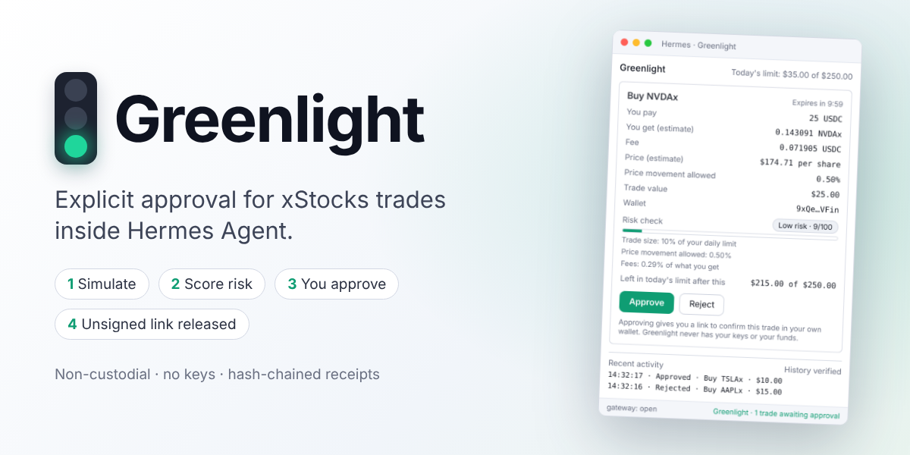
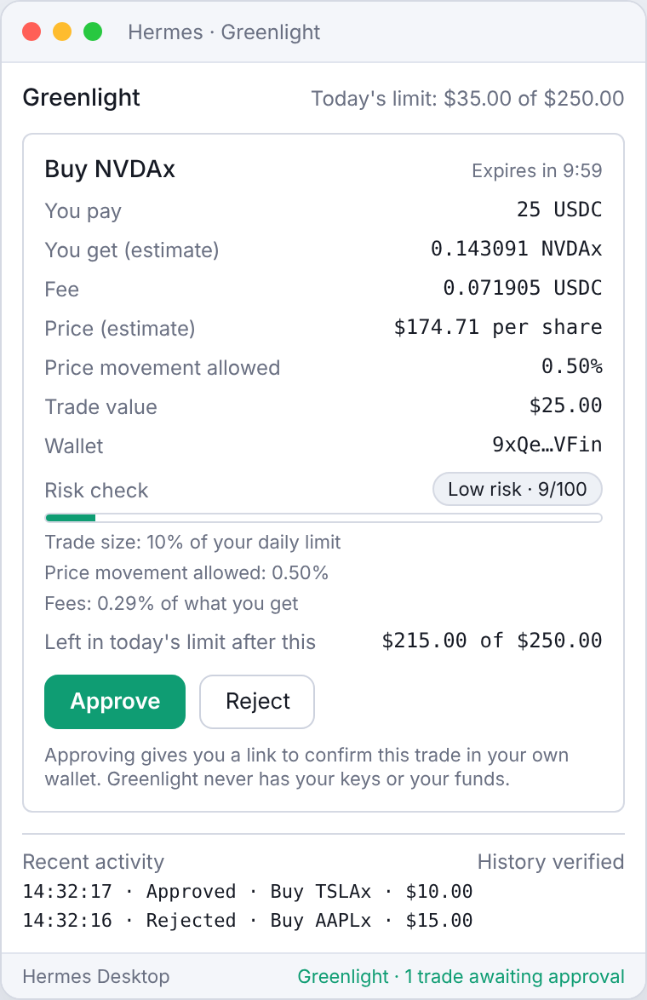
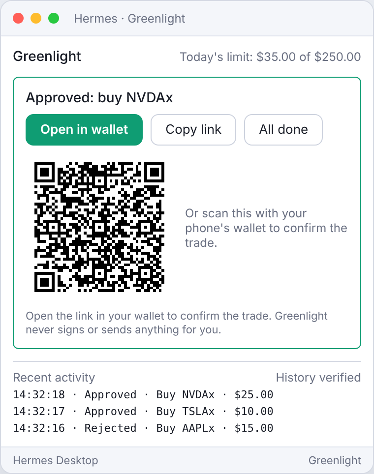
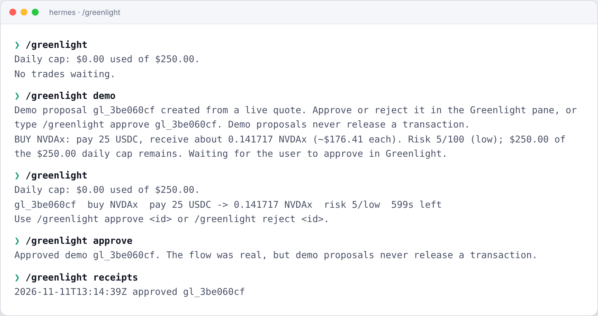

<p align="center"></p>

# Greenlight

**You approve every trade. Nothing happens without your yes.**

   

Greenlight adds a safety step to trading xStocks (tokenized US stocks on Solana, like NVDAx and AAPLx) with Hermes. Ask Hermes for a trade and Greenlight shows you exactly what would happen: what you pay, what you get, the fees and a simple risk check. Only when you press **Approve** do you get a link that opens the trade in your own wallet. Your wallet makes the final confirmation, so Greenlight never holds your keys or your money.

## Why you'll like it
- **Plain, clear trades.** Price, fees, risk and your remaining daily limit, all in one window.
- **You're always in control.** Hermes cannot send a trade on its own. It has to wait for you.
- **Live prices.** Every trade is checked against the live xStocks service before you see it.
- **Protection that stays out of the way.** Daily and per-trade limits are optional and off until you set them.
- **A history you can trust.** Every decision is saved in a record that shows if anything was changed.
- **Works where you do.** The Hermes Desktop window, plus simple `/greenlight` commands in the terminal and chat apps.

## See it
| Review the trade | After you approve |
|---|---|
|  |  |



*Screens are previews rendered from Greenlight's own interface, with live xStocks prices.*

## Get started
1. **Install** (one command in a terminal, or use **Install from Git** under Capabilities > Plugins in Hermes Desktop with the same address):
   ```bash
   hermes plugins install https://github.com/Datwebguy/greenlight
   hermes plugins enable greenlight
   ```
2. **Switch it on** in Hermes Desktop under Capabilities > Plugins.
3. **Add your wallet address** in Greenlight's settings (your public address only, never a private key or seed phrase).
4. **Try a practice trade** with no wallet or funds: type `/greenlight practice`, or press **Try a practice trade** in the Greenlight window.

## Using Greenlight
Just talk to Hermes:

> Buy $25 of NVDAx

Hermes sets up the trade and the Greenlight window opens. Review it, then press **Approve** (or **Reject**). After approving, open the link to confirm the trade in your wallet, then press **All done**.

Prefer typing? Use these anywhere you chat with Hermes:

| Type | What it does |
|---|---|
| `/greenlight` | Shows trades waiting for you and today's limit |
| `/greenlight approve` | Approves the waiting trade (add its id if there is more than one) |
| `/greenlight reject` | Rejects it |
| `/greenlight done` | Clears an approved trade once you've confirmed it in your wallet |
| `/greenlight history` | Shows your recent activity |
| `/greenlight practice` | Runs a practice trade |

## Settings
Open Greenlight's settings page in Hermes Desktop (Capabilities > Plugins).

| Setting | What it does | Default |
|---|---|---|
| Your wallet address | Used when you don't name a wallet in your request | empty |
| Daily limit (USD) | Greenlight won't set up trades beyond this total per day | none |
| Per-trade limit (USD) | Greenlight won't set up a single trade above this amount | none |
| Only allow these stocks | A list like `NVDAx, AAPLx` | any |
| Price-change tolerance (%) | If the price gets worse than this before you approve, you get a fresh quote | 1 |
| Time to decide (minutes) | How long a trade waits for your decision | 10 |
| Time to confirm after approving (minutes) | How long the wallet link stays available | 30 |

## Your money and your keys
- Greenlight **never holds your keys or your funds**, and it never signs or sends anything. Your own wallet does that.
- Hermes **cannot** send a trade until you approve it.
- If the price moves against you between review and approval, Greenlight asks for a fresh quote instead of sending a stale one.
- Your history is saved on your computer, in a record that shows if anything was changed.

## Questions
**Do I need a wallet to try it?** No. Use a practice trade.

**What if I do nothing?** The trade expires after the time you set and nothing happens.

**Can Hermes trade without me?** No. Every trade waits for your approval.

**Do I need to install anything else?** No. Greenlight works out of the box. If Node.js 18 or newer happens to be installed, it uses the official xStocker SDK for prices; if not, it talks to the same xStocks service directly.

**Where is my data?** On your computer, in Hermes' plugin data folder. Nothing is sent anywhere except price requests to the xStocks service.

<details>
<summary><strong>Transparency</strong></summary>

- **Network:** talks to `api.xstocker.com` and `xstocker.com` through the official xStocker SDK. No other services, no telemetry.
- **Code:** the official xStocker SDK is bundled unmodified (`vendor/agent-sdk`, with its checksums in `VENDORED.md`) and used when Node.js 18+ is installed. Without Node.js, Greenlight calls the same public xStocks endpoints directly using Python's standard library. Either way, nothing is installed or downloaded while the plugin runs, and it never updates itself.
- **Processes:** with Node.js, a short-lived process per price request, started with a fixed command (`node sdk-bridge.js`). No shell, and never a command chosen by the AI. Without Node.js, no extra process is started.
- **Files:** writes only to `<HERMES_HOME>/plugin-data/greenlight/`. Reads no credentials.
</details>

<details>
<summary><strong>For developers</strong></summary>

**What Greenlight registers**

| Surface | Details |
|---|---|
| Tools | `propose_trade` (simulate and create a pending trade, never returns a transaction), `get_trade_status` (look up a trade or signature; the unsigned link appears only after approval), `list_receipts` (recent receipts with chain verification) |
| Hooks | `pre_tool_call` blocks other tools from carrying an xStocks order link no approved trade released; `pre_llm_call` keeps the agent aware of pending and approved trades |
| Command | `/greenlight` |
| Desktop | approval pane, status-bar chip, notifications |
| Skill | `greenlight` (teaches the agent the flow and how to talk to users) |

**Flow**
```mermaid
sequenceDiagram
    participant U as User
    participant H as Hermes agent
    participant G as Greenlight
    participant X as xStocks API
    U->>H: "Buy $25 of NVDAx"
    H->>G: propose_trade
    G->>X: build order (simulation)
    X-->>G: quote + unsigned tx
    Note over G: keeps only the quote, discards the tx
    G-->>H: summary + risk, no transaction
    G-->>U: Desktop window / chip / notification
    U->>G: Approve (window or /greenlight approve)
    G->>X: rebuild order fresh
    G-->>G: refuse release if the quote drifted
    G-->>H: get_trade_status releases solanaPayUrl
    H-->>U: link; wallet signs and sends
    G-->>G: write hash-chained receipt
```

**Price source.** `bridge.py` uses the bundled official SDK through `sdk-bridge.js` when Node.js 18+ is present, and otherwise calls the same three public endpoints (`assets.json`, `build-order`, `order/{signature}`) directly. A busy service is retried once, and the last good stock list is reused if it briefly fails.

**Simulation.** Each proposal is built against the live xStocks API through the official SDK, giving a real route, expected output, fee and slippage. On approval the order is rebuilt (unsigned transactions are short-lived) and release is refused if the fresh quote is worse than the approved one by more than `max_quote_drift_pct`.

**Risk check.** A transparent 0-100 score: trade size relative to the daily limit (when set), slippage, fees, SOL price exposure, and wallet-link availability.

**Configuration keys** (`plugins.entries.greenlight.settings`): `default_wallet`, `daily_cap_usd`, `max_trade_usd`, `allowed_assets`, `max_quote_drift_pct`, `proposal_ttl_minutes`, `release_window_minutes`. All limits default to off.

**Development**
```bash
pip install pytest fastapi httpx pyyaml
python -m pytest tests                  # 29 tests, no network needed
hermes plugins validate . --install-deps
```
Validated with `hermes plugins validate` and `hermes plugins doctor` on Hermes v0.23.1.
</details>

## Links
- [xStocker Agent SDK](https://www.npmjs.com/package/@xstocker/agent-sdk)
- [xStocks docs](https://docs.xstocks.fi)
- [Hermes plugin guide](https://github.com/NousResearch/hermes-agent/blob/main/website/docs/developer-guide/plugins/index.md)

## License
MIT. See [LICENSE](LICENSE).
